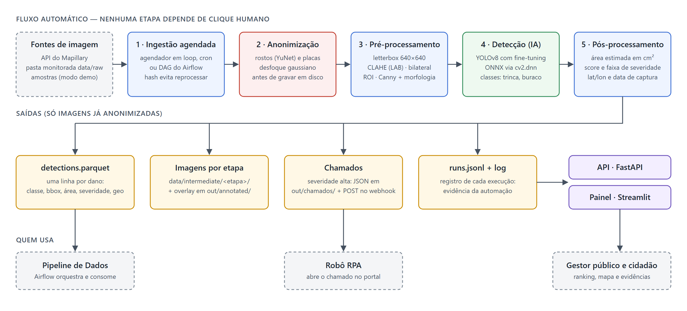

# Zeladoria Viária com Visão Computacional

Detecta e mede danos em vias a partir de imagens de rua, prioriza por severidade e
abre o chamado — sem ninguém clicar em nada.

> Global Solution 2026.2 · FIAP 4ESPA · Applied Computer Vision (Prof. Claudiney Sanches Junior)



## Ficha Técnica do MVP

| Campo | |
|---|---|
| Nome do produto | _(definir: ViaCerta / BuracoZero / RuaLimpa.ai)_ |
| Cidadão e território | Moradores e pedestres (incluindo idosos e pessoas com deficiência) de _[cidade/bairro]_ que convivem com buracos e calçadas quebradas |
| Problema, em uma frase | Danos em vias e calçadas só são consertados depois de reclamações manuais, lentas e sem priorização objetiva |
| Proposta de valor | Detecta e mede danos automaticamente a partir de imagens, gera um ranking de prioridade com localização e abre o chamado sem intervenção humana |
| Arquitetura | Ingestão agendada → anonimização → pré-processamento → detecção (YOLO) → pós-processamento → saída estruturada → API/UI → webhook RPA |
| Fontes de dados | RDD2022 (treino), Mapillary e fotos do grupo (operação) — ver [data/DATASETS.md](data/DATASETS.md) |
| Modelos de IA | YOLOv8s com fine-tuning (inferência em ONNX); YuNet para rostos; baseline clássico OpenCV |
| URL do MVP | _(preencher)_ |
| Repositório | _(preencher)_ |
| Vídeo | _(preencher)_ |
| Indicadores de impacto | Tempo de triagem por imagem; precisão e recall; danos de severidade alta com chamado aberto |
| ODS conectados | 11 (cidades sustentáveis), 10 (redução das desigualdades), 9 (infraestrutura) |
| Integrantes | _(nome · RM)_ |

Documentação: [relatório de transformações](docs/relatorio_transformacoes.md) ([PDF](docs/relatorio.pdf)) ·
[dicionário de dados](docs/dicionario_dados.md) · [fontes de dados](data/DATASETS.md) ·
[roteiro do vídeo](docs/roteiro_video.md)

## Como rodar

Com Docker (agendador + API + painel):

```bash
cp .env.example .env        # opcional: token do Mapillary, webhook, modo demonstração
docker compose up --build
```

- Painel: http://localhost:8501
- API: http://localhost:8000/docs

Coloque qualquer foto em `data/raw/`. Na próxima execução do agendador
(a cada `PIPELINE_INTERVAL_SECONDS`, padrão 5 min) ela aparece no painel com
todas as etapas, os dados extraídos e, se a severidade for alta, um chamado em
`data/out/chamados/`. Para ver o fluxo sem ter fotos, use `DEMO_SEED_PER_RUN=1` no
`.env`: a cada execução entra uma imagem de exemplo de `samples/`.

Sem Docker:

```bash
python -m venv .venv && .venv\Scripts\activate      # Linux/macOS: source .venv/bin/activate
pip install -r requirements-dev.txt
python -m scheduler.run_pipeline --loop --interval 60   # agendador
uvicorn src.api.main:app --reload                       # API (outro terminal)
streamlit run src/ui/app.py                             # painel (outro terminal)
```

Testes: `pytest -q`

## O que acontece com cada imagem

```
data/raw/  (Mapillary, pasta monitorada ou amostras do modo demonstração)
   │
   ▼
anonimização ──► rostos (YuNet) e placas desfocados antes de qualquer gravação
   │
   ▼
pré-processamento ──► data/intermediate/<etapa>/<id>.jpg
   00_original · 01_letterbox · 02_clahe · 03_bilateral · 04_roi · 05_baseline_canny
   │
   ▼
detecção (YOLOv8s em ONNX; sem pesos, baseline clássico)
   │
   ▼
pós-processamento ──► área em cm², score e faixa de severidade, lat/lon
   │
   ├──► data/out/detections.parquet        (dicionário: docs/dicionario_dados.md)
   ├──► data/out/annotated/<id>.jpg        (overlay)
   ├──► data/out/chamados/chamado_<id>.json + POST no WEBHOOK_URL   (severidade alta)
   └──► data/out/runs.jsonl                (evidência de cada execução automática)
```

A imagem bruta nunca é publicada: a API e o painel só servem arquivos gerados
depois da anonimização, e `data/raw/` fica fora do git.

## Modelo

YOLOv8s com fine-tuning no [RDD2022](data/DATASETS.md) (17.584 imagens de treino,
1.966 de validação; Japão, EUA, Índia e República Tcheca), com duas classes:
`trinca` e `buraco`. Os pesos estão em `weights/` (`best.onnx` + `classes.txt`) e a
inferência usa `cv2.dnn`, então o container não precisa de PyTorch.

| Validação (1.966 imagens) | Precisão | Recall | mAP50 | mAP50-95 |
|---|---|---|---|---|
| todas as classes | 0,625 | 0,526 | 0,580 | 0,273 |
| trinca | 0,627 | 0,626 | 0,655 | 0,333 |
| buraco | 0,622 | 0,427 | 0,506 | 0,213 |

Curvas, matriz de confusão e a comparação com o baseline clássico estão no
[relatório](docs/relatorio_transformacoes.md#5-modelo) e em `docs/evidencias/`.

Para treinar de novo (GPU local ou o notebook [notebooks/treino_colab.ipynb](notebooks/treino_colab.ipynb)):

```bash
pip install -r requirements-ml.txt
python -m src.model.prepare_rdd2022 --download India Japan United_States Czech   # ~2,3 GB
python -m src.model.train --data data/dataset/data.yaml --model yolov8s.pt --epochs 30 --batch 32
python -m src.model.evaluate --data data/dataset/data.yaml
python -m src.model.compare_baseline          # baseline clássico × YOLO, sem PyTorch
```

O modelo recebe a imagem anonimizada com letterbox (`DETECT_ON=letterbox`). Na comparação
em 300 imagens de validação, essa entrada teve recall 0,577 contra 0,463 da imagem após
CLAHE + bilateral, com a mesma precisão (0,65); o baseline clássico ficou em 0,007.

Sem `weights/best.onnx`, o pipeline cai no baseline clássico (coluna
`modelo = baseline_opencv`), que serve para comparação — não para decidir reparo.

## Severidade

```
score = 0.5 × min(área_cm² / 10000, 1) + 0.2 × confiança + 0.3 × peso_da_classe
peso_da_classe: buraco 1.0 · calçada_quebrada 0.7 · trinca 0.4
baixa < 0.40 ≤ média < 0.65 ≤ alta
```

Pesos e faixas ficam em [src/postprocess/severity.py](src/postprocess/severity.py)
e em `GET /severity-formula`. A área é uma estimativa: caixa detectada × fator de
ocupação da classe (buraco 0,8; trinca 0,3) × escala fixa de cm por pixel, sem
correção de perspectiva. Danos de severidade alta devem ser validados por uma pessoa.

## Coleta autônoma

| Origem | Como ativar |
|---|---|
| Pasta monitorada | Nada a configurar: qualquer imagem nova em `data/raw/` é processada |
| Mapillary | `MAPILLARY_TOKEN` e `MAPILLARY_BBOX` no `.env`; cada execução baixa até `MAPILLARY_LIMIT` imagens novas da região (a área da bbox precisa ser menor que 0,01 grau²) |
| Modo demonstração | `DEMO_SEED_PER_RUN=1`: uma imagem de `samples/` por execução, identificada na coluna `fonte` |

### Limite de imagens guardadas

Cada imagem processada ocupa cerca de 0,8 MB (original anonimizada, etapas e overlay).
Para a pasta `data/` não crescer até encher o disco, só as `MAX_IMAGES` mais recentes
ficam guardadas (padrão: 200; `0` desliga o limite). Ao passar do limite, cada execução
remove das imagens mais antigas as etapas, o overlay e as linhas do parquet, e registra
quantas saíram em `imagens_removidas` no `runs.jsonl`.

Não são removidos: os chamados já abertos, as fotos colocadas à mão em `data/raw/` e as
amostras de demonstração. Uma imagem removida nunca é processada nem baixada de novo
(`processed.json` e `mapillary_seen.json` guardam os ids).

Agendamento: `docker compose` (serviço `scheduler`), `python -m scheduler.run_pipeline --loop`,
cron/Agendador de Tarefas chamando `python -m scheduler.run_pipeline`, ou a DAG
do Airflow em [scheduler/dag_zeladoria.py](scheduler/dag_zeladoria.py).

## Deploy público

A imagem do `Dockerfile` sozinha já é o MVP: sobe o painel, o agendador e o modo
demonstração no mesmo container (uma imagem de exemplo por minuto), para a URL não
ficar vazia em plataformas com disco efêmero.

| Plataforma | Passos |
|---|---|
| Render | New > Blueprint > selecionar o repositório (usa [render.yaml](render.yaml)) |
| Hugging Face Spaces | Criar um Space com SDK **Docker**, enviar o repositório e acrescentar ao topo do README do Space o bloco `---`/`sdk: docker`/`app_port: 8501`/`---` |
| Qualquer VM | `docker compose up -d --build` e liberar as portas 8501 e 8000 |

No plano gratuito do Render o disco é temporário: a pasta `data/` volta vazia a cada
deploy, a cada mudança de variável de ambiente e quando o serviço acorda depois de ficar
parado. O histórico recomeça e a coleta enche o painel de novo sozinha; o próprio painel
avisa isso e mostra desde quando há histórico. Para manter os dados entre deploys é preciso
um disco persistente (pago) ou rodar com `docker compose`, que usa a pasta `./data`.

Para coleta real no deploy, cadastre `MAPILLARY_TOKEN`, `MAPILLARY_BBOX` e `WEBHOOK_URL`
como variáveis de ambiente da plataforma (nunca no repositório).

## Relatório em PDF

```bash
python docs/collect_evidence.py                 # copia etapas, amostra de dados e execuções para docs/evidencias/
python docs/build_pdf.py --repo-url https://github.com/<usuario>/<repo>
```

Gera `docs/relatorio.pdf` com links clicáveis, usando o Edge ou o Chrome instalado.

## Estrutura

```
src/
├── ingest/        fetch_mapillary.py, watch_folder.py, seed_samples.py
├── preprocess/    steps.py (uma função por etapa), pipeline.py
├── privacy/       blur_faces_plates.py + modelo YuNet
├── model/         infer.py, prepare_rdd2022.py, train.py, evaluate.py, compare_baseline.py
├── postprocess/   severity.py, geo.py, output.py
├── api/           main.py (FastAPI)
├── ui/            app.py (Streamlit)
└── pipeline.py    orquestra uma imagem e uma execução
scheduler/         run_pipeline.py, dag_zeladoria.py
weights/           best.onnx, classes.txt
samples/           imagens de exemplo (RDD2022, CC BY 4.0)
tests/             etapas, pipeline ponta a ponta, API, painel, dataset
docs/              relatório, dicionário de dados, roteiro, arquitetura, evidencias/
data/              DATASETS.md + pastas geradas (fora do git)
```

## Integração com as outras disciplinas

| Disciplina | Ponto de integração |
|---|---|
| Dados | `data/out/detections.parquet` e a DAG `zeladoria_cv` |
| RPA | `data/out/chamados/*.json`, `GET /tickets` ou `WEBHOOK_URL` |
| DevOps | `Dockerfile`, `docker-compose.yml`, `render.yaml`, `.github/workflows/ci.yml` (testes, Gitleaks, build) |
| BI | `GET /stats`, `GET /ranking`, parquet |

## Limitações conhecidas

- O modelo foi treinado com vias de outros países e só com as classes `trinca` e `buraco`;
  `calcada_quebrada` depende de fotos anotadas pelo grupo.
- A área em cm² depende de uma escala assumida (`SCENE_WIDTH_CM`) ou de `cm_per_px` informado por imagem.
- A anonimização pode falhar em rostos muito pequenos ou de costas e em placas inclinadas.
- A coleta pelo Mapillary devolve fotos em sequência do mesmo trajeto, então os pontos tendem a
  ficar concentrados em um trecho da área configurada, e não espalhados por ela.
- O histórico é limitado a `MAX_IMAGES` imagens e, em hospedagem com disco temporário (Render
  gratuito), recomeça a cada deploy.

## Licenças de terceiros

RDD2022: CC BY 4.0 · Mapillary: CC BY-SA 4.0 · Ultralytics YOLOv8: AGPL-3.0 ·
YuNet (OpenCV Zoo): MIT.
