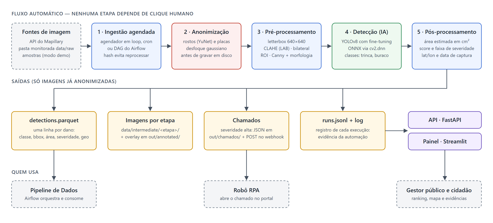
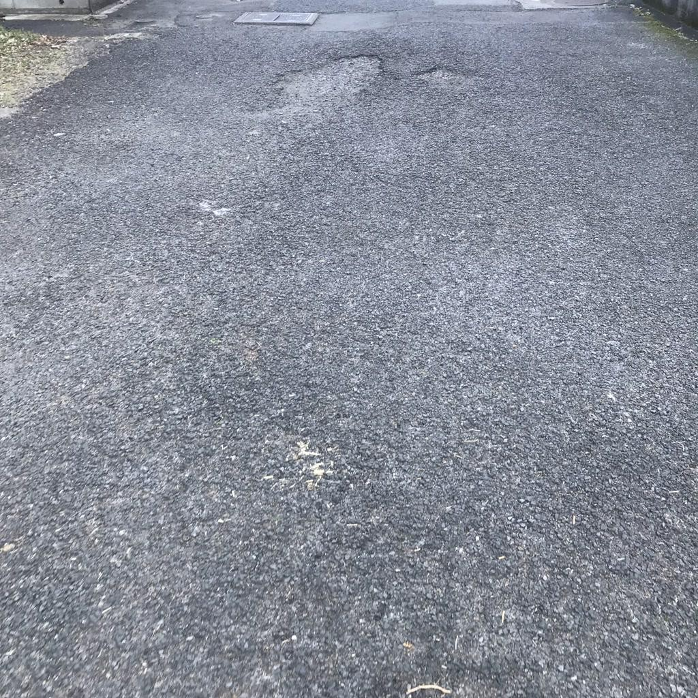
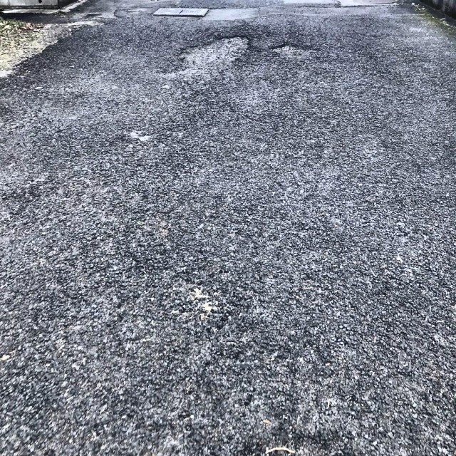
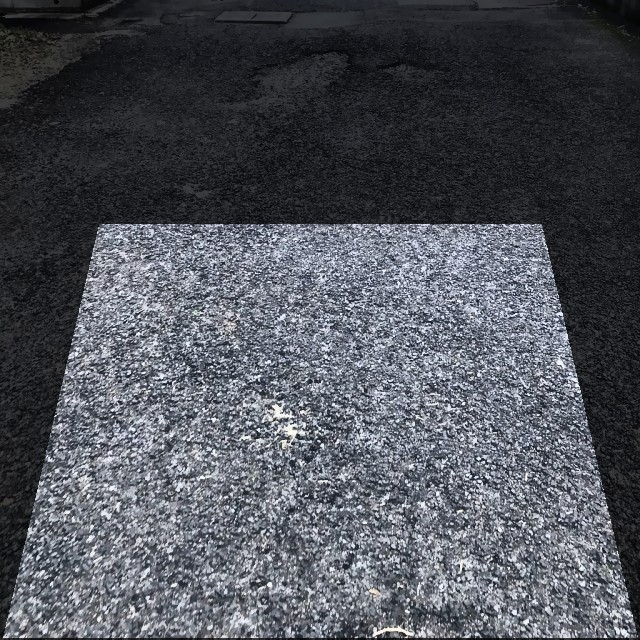
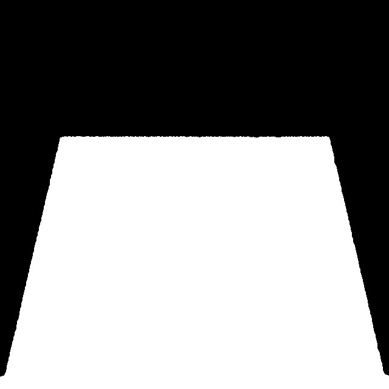
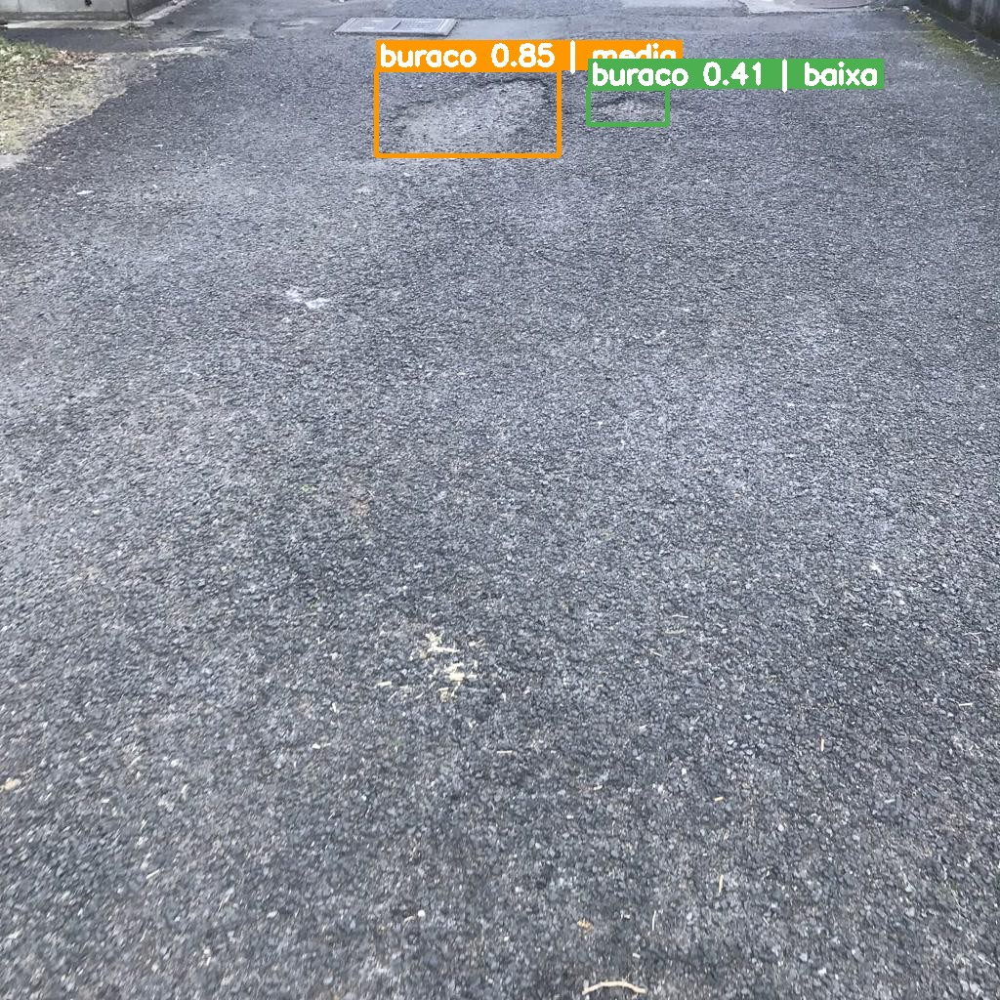
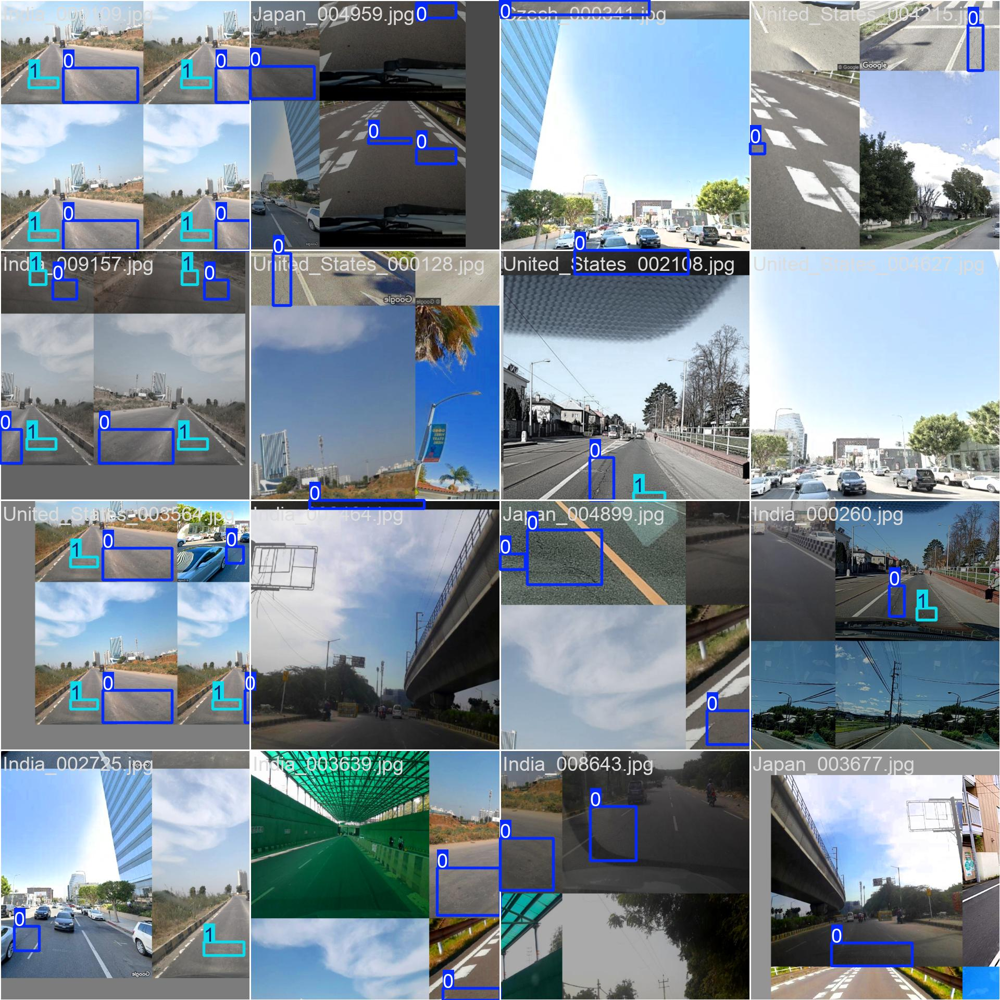
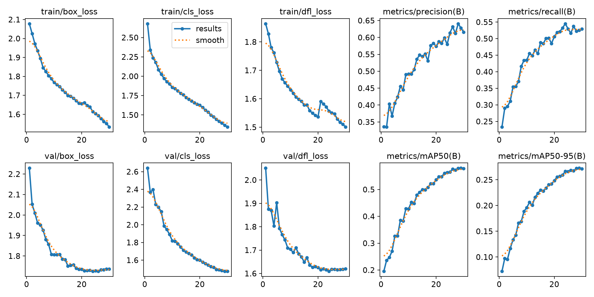
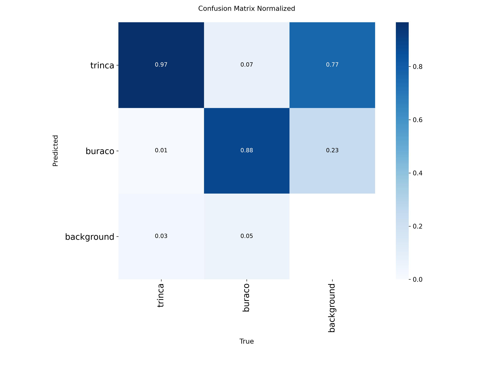
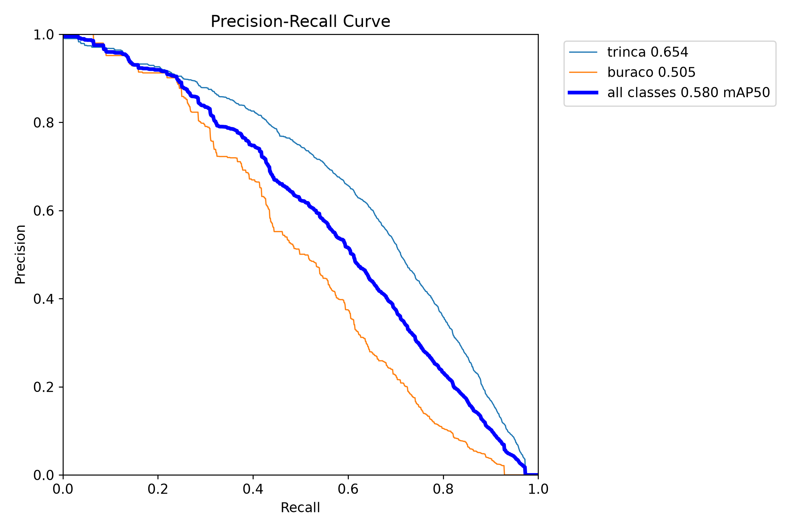

# Zeladoria Viária com Visão Computacional — transformações e dados extraídos

> Global Solution 2026.2 · FIAP 4ESPA · Applied Computer Vision · Prof. Claudiney Sanches Junior
> Integrantes: _(nome · RM)_

**Links**

| | |
|---|---|
| Vídeo (≤ 5 min) | _(preencher)_ |
| MVP (URL pública) | _(preencher)_ |
| Repositório | _(preencher)_ |
| Imagens intermediárias | [docs/evidencias/etapas/](evidencias/etapas/) |
| Dados extraídos | [docs/evidencias/amostra_detections.csv](evidencias/amostra_detections.csv) e `GET /detections` na URL do MVP |
| Evidências do treino | [docs/evidencias/treino/](evidencias/treino/) |

## 1. Ficha Técnica do MVP

| Campo | |
|---|---|
| Nome do produto | _(definir)_ |
| Cidadão e território | Moradores e pedestres (incluindo idosos e pessoas com deficiência) de _[cidade/bairro]_ que convivem com buracos e calçadas quebradas |
| Problema | Danos em vias e calçadas só são consertados depois de reclamações manuais, lentas e sem priorização objetiva |
| Proposta de valor | Detecta e mede danos automaticamente a partir de imagens, gera um ranking de prioridade com localização e abre o chamado sem intervenção humana |
| Fontes de dados | RDD2022 (CC BY 4.0) para treino; Mapillary (CC BY-SA 4.0) e fotos do grupo na operação |
| Modelos de IA | YOLOv8s com fine-tuning (inferência em ONNX); YuNet para rostos; baseline clássico OpenCV |
| Indicadores de impacto | Tempo de triagem por imagem; precisão e recall; danos de severidade alta com chamado aberto |
| ODS | 11 (cidades sustentáveis), 10 (redução das desigualdades), 9 (infraestrutura) |

## 2. Problema, cidadão e ODS

_(preencher com o território escolhido: quem é afetado, como o problema aparece hoje e a ligação com os ODS 11, 10 e 9)_

## 3. Arquitetura



O agendador executa o fluxo inteiro a cada intervalo configurado. Cada imagem nova é
identificada pelo hash do conteúdo, anonimizada em memória, transformada, analisada
pelo modelo e convertida em linhas de dados. Nenhuma etapa depende de clique humano.

## 4. Transformações realizadas

As imagens desta seção são de uma mesma foto processada pelo pipeline
(`data/intermediate/<etapa>/<id>.jpg`). Parâmetros conforme o código em
`src/preprocess/steps.py` e `src/privacy/blur_faces_plates.py`.

### 4.0 Anonimização (antes de qualquer gravação)

Rostos são localizados pelo detector YuNet (limiar 0,5) e placas por Haar cascade
(`scaleFactor=1.1`, `minNeighbors=4`). Cada região é expandida em 15% e desfocada com
filtro gaussiano de kernel proporcional ao tamanho da região. A operação acontece em
memória: a imagem "original" gravada abaixo já é a versão anonimizada, e a imagem bruta
nunca é publicada. **Por quê:** LGPD by design — o sistema só precisa do pavimento.

### 4.1 Letterbox 640×640

| Antes (original anonimizada) | Depois |
|---|---|
|  |  |

Redimensiona mantendo a proporção (`INTER_AREA`) e completa com bordas cinza (114).
**Por quê:** padroniza a entrada do modelo sem deformar o dano; a escala e o deslocamento
são guardados para devolver as caixas às coordenadas da foto original.

### 4.2 Correção de iluminação — CLAHE no canal L (LAB)

| Antes | Depois |
|---|---|
|  |  |

Equalização adaptativa com `clipLimit=2.0` e grade 8×8, aplicada só à luminância.
**Por quê:** sombras e sol forte escondem trincas; atuar só no canal L realça o relevo do
pavimento sem alterar as cores.

### 4.3 Redução de ruído — filtro bilateral

| Antes | Depois |
|---|---|
|  |  |

`d=7`, `sigmaColor=50`, `sigmaSpace=50`. **Por quê:** remove a granulação do asfalto (que o
CLAHE amplifica) preservando as bordas do dano, ao contrário de um desfoque gaussiano.

### 4.4 Região de interesse

| Antes | Depois |
|---|---|
|  |  |

Máscara trapezoidal que começa a 35% da altura da cena, com o topo recuado 15% de cada lado.
**Por quê:** concentra a análise clássica na pista e descarta céu, fachadas e veículos distantes.

### 4.5 Baseline clássico — Canny + morfologia

| Antes | Depois (máscara de candidatos) |
|---|---|
|  |  |

Desfoque 5×5, Canny (50/150), fechamento com elemento elíptico 9×9 (2 iterações),
preenchimento dos contornos e abertura. Contornos alongados viram `trinca`, compactos viram
`buraco`. **Por quê:** é a referência sem IA, para medir o ganho do deep learning (seção 5.2).
Neste exemplo a máscara preenche a região de interesse inteira: a granulação do asfalto gera
bordas por toda parte, e o fechamento morfológico as une em um único bloco, que é descartado
por ser grande demais. É o motivo de o método clássico falhar em fotos reais.

### 4.6 Detecção com IA e overlay

| Entrada do modelo | Saída anotada |
|---|---|
|  |  |

YOLOv8s exportado em ONNX e executado com `cv2.dnn` (confiança ≥ 0,25, NMS com IoU 0,45).
O modelo recebe a imagem anonimizada com letterbox, que foi a entrada com melhor resultado
na comparação da seção 5.2. As caixas voltam para as coordenadas da foto original e são
desenhadas com a cor da severidade (verde = baixa, laranja = média, vermelho = alta).

### 4.7 Data augmentation (só no treino)



Mosaico de 4 imagens, flip horizontal, variação de matiz/saturação/brilho, e, via
Albumentations, desfoque, CLAHE e tons de cinza com baixa probabilidade.
**Por quê:** robustez a iluminação, ângulo e qualidade de câmera diferentes do dataset.

## 5. Modelo

| | |
|---|---|
| Arquitetura | YOLOv8s (11 milhões de parâmetros), pré-treinado em COCO, fine-tuning completo |
| Dataset | RDD2022, subconjuntos Japão, EUA, Índia e República Tcheca — 17.584 imagens de treino e 1.966 de validação (ver `data/DATASETS.md`) |
| Classes | `trinca` (D00, D10 e D20 do RDD2022) e `buraco` (D40) |
| Treino | 30 épocas, 640 px, batch 32, AdamW, GPU NVIDIA RTX 5070 (cerca de 55 minutos) |
| Inferência | ONNX em CPU, cerca de 131 ms por imagem |

### 5.1 Métricas na validação (1.966 imagens)

| Classe | Precisão | Recall | mAP50 | mAP50-95 |
|---|---|---|---|---|
| todas | 0,625 | 0,526 | 0,580 | 0,273 |
| trinca | 0,627 | 0,626 | 0,655 | 0,333 |
| buraco | 0,622 | 0,427 | 0,506 | 0,213 |

| Curvas de treino | Matriz de confusão (normalizada) |
|---|---|
|  |  |



### 5.2 Baseline clássico × YOLO

Mesmas 300 imagens de validação (amostra espalhada pelos quatro países, 555 danos anotados), processadas pelas funções do próprio pipeline. Uma detecção conta como acerto quando a classe é a mesma e a sobreposição com a anotação é IoU ≥ 0,5. Gerado por `python -m src.model.compare_baseline` ([comparacao_baseline.json](evidencias/comparacao_baseline.json)).

| Método | Acertos | Falsos positivos | Danos não detectados | Precisão | Recall | Tempo por imagem |
|---|---|---|---|---|---|---|
| Baseline (Canny + morfologia) | 4 | 603 | 551 | 0,007 | 0,007 | 6 ms |
| YOLO na imagem só redimensionada | 320 | 172 | 235 | 0,650 | 0,577 | 132 ms |
| YOLO após CLAHE + bilateral | 257 | 135 | 298 | 0,656 | 0,463 | 131 ms |

**O que os números mostram**

- O baseline clássico praticamente não acerta em fotos reais: bordas de sombras, faixas e
  texturas geram centenas de candidatos, e quase nenhum coincide com um dano anotado. O ganho
  do deep learning é a diferença entre 0,7% e 58% de recall. Não é questão de ajuste: seis
  combinações de suavização (5 a 17 px), limiares de Canny e tamanho do elemento morfológico
  foram testadas em 200 imagens, e nenhuma passou de 2,2% de recall.
- O YOLO acerta mais na imagem só redimensionada (recall 0,577) do que na imagem após CLAHE e
  filtro bilateral (0,463), com precisão igual. O modelo foi treinado com imagens originais, e
  o pré-processamento muda a textura que ele aprendeu. Por isso o pipeline entrega ao modelo a
  imagem anonimizada com letterbox (`DETECT_ON=letterbox`); CLAHE, bilateral e ROI alimentam o
  baseline clássico e as evidências visuais. Treinar o modelo já com as imagens pré-processadas
  é um próximo passo para medir se o realce de contraste ajuda quando está também no treino.

### 5.3 Limitações e vieses

- O dataset não tem imagens do Brasil. Pavimento, sinalização e iluminação diferentes podem
  reduzir a precisão no território; por isso as fotos do grupo entram como validação.
- Há cinco vezes mais trincas do que buracos no treino, e todas as fotos são diurnas e tiradas
  de veículos. Imagens noturnas, com chuva ou feitas por pedestres estão fora da distribuição.
- A classe `calcada_quebrada` prevista no plano não existe no RDD2022 e não foi treinada.
- Sombras, remendos e tampas de bueiro são as principais fontes de falso positivo.

## 6. Dados extraídos

Cada dano detectado vira uma linha em `data/out/detections.parquet`. Dicionário completo em
[dicionario_dados.md](dicionario_dados.md).

| Campo | Como é obtido |
|---|---|
| `classe`, `confianca`, `bbox` | Saída do detector, com a caixa convertida para as coordenadas da foto original |
| `area_cm2` | área da caixa em pixels × fator de ocupação da classe (buraco 0,8; trinca 0,3) × (cm/pixel)²; escala = `SCENE_WIDTH_CM` (400 cm) ÷ largura da imagem, ou `cm_per_px` informado para a foto |
| `score_severidade`, `severidade` | Fórmula abaixo |
| `lat`, `lon`, `captured_at` | Metadados do Mapillary ou EXIF da foto |
| `fonte`, `licenca` | Registrados na ingestão |
| `regioes_anonimizadas` | Número de rostos/placas desfocados na imagem |

**Score de severidade**

```
score = 0,5 × min(área_cm² / 10000, 1) + 0,2 × confiança + 0,3 × peso_da_classe
peso_da_classe: buraco = 1,0 · calçada_quebrada = 0,7 · trinca = 0,4
baixa: score < 0,40 · média: 0,40 ≤ score < 0,65 · alta: score ≥ 0,65
```

A área pesa mais porque determina o risco e o custo do reparo (satura em 1 m²); a classe
entra porque um buraco é mais perigoso que uma trinca de mesma área; a confiança evita
priorizar detecções duvidosas. O fator de ocupação existe porque uma trinca é uma linha que
ocupa só parte da caixa detectada; os valores 0,8 e 0,3 são heurísticos. A área é uma
estimativa (escala fixa, sem correção de perspectiva), então todo caso de severidade alta
gera um chamado que uma pessoa valida antes do reparo.

**Amostra real do `detections.parquet`**

| id | classe | confianca | bbox | area_cm2 | score_severidade | severidade | lat | lon | fonte |
|---|---|---|---|---|---|---|---|---|---|
| det_5c12b2558630_00 | buraco | 0.847 | [385, 71, 187, 88] | 2038.2 | 0.5713 | média |  |  | RDD2022 (amostra de demonstração) |
| det_5c12b2558630_01 | buraco | 0.405 | [602, 90, 81, 37] | 375.9 | 0.3998 | baixa |  |  | RDD2022 (amostra de demonstração) |
| det_ac1481462be9_00 | buraco | 0.496 | [0, 428, 324, 290] | 23251.8 | 0.8992 | alta |  |  | RDD2022 (amostra de demonstração) |
| det_c91906f0b3c1_01 | buraco | 0.286 | [326, 462, 393, 180] | 17494.9 | 0.8572 | alta |  |  | RDD2022 (amostra de demonstração) |
| det_a0e7a5b077e9_00 | trinca | 0.87 | [0, 343, 592, 256] | 20291.2 | 0.794 | alta |  |  | RDD2022 (amostra de demonstração) |
| det_c91906f0b3c1_00 | buraco | 0.744 | [70, 577, 86, 44] | 947.5 | 0.4962 | média |  |  | RDD2022 (amostra de demonstração) |
| det_1d4fcde0a823_00 | buraco | 0.762 | [88, 578, 62, 42] | 660.3 | 0.4854 | média |  |  | RDD2022 (amostra de demonstração) |
| det_e0c24df435a6_00 | trinca | 0.934 | [16, 511, 104, 108] | 1325.8 | 0.3731 | baixa |  |  | RDD2022 (amostra de demonstração) |

## 7. Automação

- **Gatilho:** agendador em loop (`python -m scheduler.run_pipeline --loop`, serviço `scheduler`
  do docker-compose) ou a DAG `zeladoria_cv` no Airflow.
- **Coleta:** API do Mapillary para a área configurada e pasta monitorada `data/raw/`.
- **Idempotência:** cada imagem é identificada pelo hash do conteúdo e processada uma única vez.
- **Saída:** `detections.parquet`, imagens de cada etapa e, para severidade alta com confiança
  de pelo menos 0,4, um arquivo em `data/out/chamados/` e um POST no webhook do robô RPA.

**Evidência — execuções consecutivas do agendador** (`data/out/runs.jsonl`, uma linha por execução):

| Execução | Início | Fim | Imagens novas | Processadas | Danos | Chamados | Erros |
|---|---|---|---|---|---|---|---|
| `1ffe97e7` | 06:42:10 | 06:42:11 | 2 | 2 | 4 | 0 | 0 |
| `265c6075` | 06:42:26 | 06:42:26 | 2 | 2 | 2 | 0 | 0 |
| `5e001ea0` | 06:42:41 | 06:42:42 | 2 | 2 | 3 | 1 | 0 |
| `bedb5dd9` | 06:42:57 | 06:42:57 | 2 | 2 | 4 | 1 | 0 |
| `4702997e` | 06:43:12 | 06:43:12 | 0 | 0 | 0 | 0 | 0 |
| `db88495d` | 06:43:27 | 06:43:27 | 0 | 0 | 0 | 0 | 0 |

Execuções reais do agendador com intervalo de 15 segundos e o modo demonstração ligado
(duas imagens de `samples/` entram por execução, como se tivessem acabado de chegar). As duas
últimas execuções não encontraram imagem nova e não reprocessaram nada. Dos três danos de
severidade alta, dois abriram chamado; o terceiro tinha confiança 0,29, abaixo do mínimo de
0,4, e ficou só no ranking, para validação humana. Arquivo completo em
[evidencias/runs.jsonl](evidencias/runs.jsonl).

_(substituir por execuções com imagens do Mapillary ou do território quando o token e as fotos estiverem disponíveis)_

**Chamado gerado para um dano de severidade alta:**

```json
{
  "id": "det_a0e7a5b077e9_00",
  "classe": "trinca",
  "severidade": "alta",
  "score_severidade": 0.794,
  "confianca": 0.87,
  "area_cm2": 20291.2,
  "lat": null,
  "lon": null,
  "captured_at": "2026-11-14T06:42:57-03:00",
  "img_anotada": "out/annotated/a0e7a5b077e9.jpg",
  "descricao": "Dano em via detectado automaticamente: trinca, área estimada 20291 cm², severidade alta (localização não informada). Requer validação humana antes do reparo."
}
```

## 8. Privacidade e LGPD

- **Anonimização:** rostos e placas desfocados em memória antes de qualquer gravação; nenhuma
  imagem intermediária, anotada ou publicada contém o original.
- **Minimização:** só são extraídos dados do dano e da localização da via; o EXIF não é copiado
  para as imagens geradas.
- **Imagens brutas:** ficam apenas em `data/raw/`, fora do repositório e fora da API.
- **Retenção:** _(preencher: por quanto tempo as imagens brutas são mantidas e quem as apaga)_
- **Limitação:** o detector pode falhar em rostos muito pequenos ou de costas e em placas
  inclinadas; imagens publicadas como evidência devem ser revisadas por uma pessoa.

## 9. Referências

- Arya, D. et al. "RDD2022: A multi-national image dataset for automatic road damage detection." *Geoscience Data Journal*, 2024. Dados: [doi:10.6084/m9.figshare.21431547.v1](https://doi.org/10.6084/m9.figshare.21431547.v1) (CC BY 4.0).
- Jocher, G. et al. Ultralytics YOLOv8. [github.com/ultralytics/ultralytics](https://github.com/ultralytics/ultralytics) (AGPL-3.0).
- Wu, W. et al. "YuNet: A Tiny Millisecond-level Face Detector." *Machine Intelligence Research*, 2023. Modelo do [OpenCV Zoo](https://github.com/opencv/opencv_zoo) (MIT).
